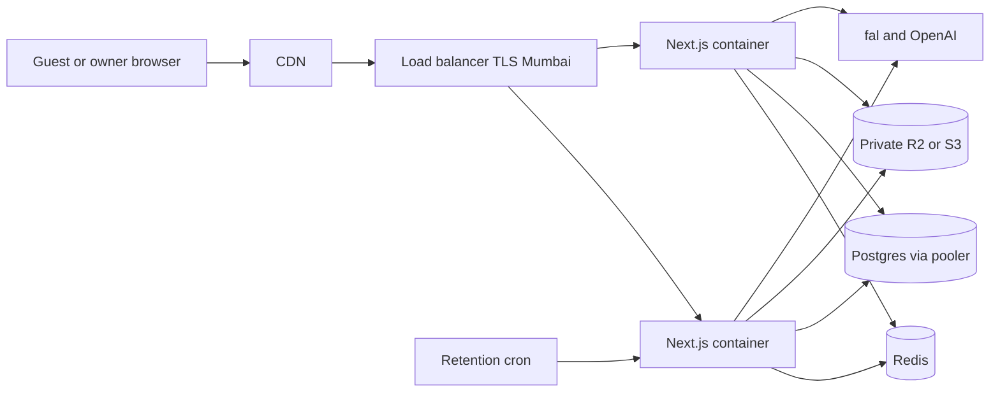

# Lookuvi production architecture

This is the target for about 20 Indian salons now, and the same shape at 500+. The app stays a multi-tenant Next.js service. A salon is a `Tenant` row. Guests, leads, bookings, and previews are stored with that tenant's id.

## Request path

Guests and salon staff hit a CDN, then a TLS load balancer, then one or more stateless Next.js containers. Containers share no disk. Sessions are JWTs (`src/auth.ts`), so any instance can serve `/admin` and `/super`. The guest cookie `helix_guest` is an HMAC signed with `AUTH_SECRET`, also valid on every instance.

A preview is still a request/response. The browser uploads a selfie, the server calls fal or OpenAI, and the JPEG is returned on that same request. A queue is not required for 20 salons: one container can wait on the provider (`maxDuration` is 3600 on the generate route) and the load balancer timeout must be at least that long. Add a job queue when provider calls regularly outlive the proxy timeout or when you want to shed load instead of holding HTTP workers. The queue would store the job id in Postgres and the worker would write the result to object storage. The browser would poll. Do not add that until a proxy is actually cutting requests off.

## Data plane

**Postgres.** Managed Postgres 16 in Mumbai (Neon, RDS, or Cloud SQL). The app uses a pooled URL (`DATABASE_URL`: Neon pooler or PgBouncer). Migrations use a direct URL (`DIRECT_URL`) because `prisma migrate deploy` in `docker-entrypoint.sh` must not run through a transaction-mode pooler. Prisma's client is the only query layer. There is no SQLite in production. The committed schema stays SQLite so local `npm test` can `db push`; `scripts/prepare-prisma.mjs` switches the provider when `DATABASE_URL` is Postgres.

**Object storage.** Selfies are not kept. The generated preview is stored under `generations/{tenantId}/{requestId}/result.jpg` for `GENERATION_JOB_TTL_HOURS` (default 24) so a repeated request id is not billed again (`src/lib/ai/dedupe.ts`). Benchmark selfies, which are super-admin only, go under `benchmarks/{id}/` and expire after `BENCHMARK_RETENTION_HOURS` (default 72). `OBJECT_STORAGE=local` writes `var/objects` for development. `OBJECT_STORAGE=s3` uses the S3 API (`src/lib/storage/s3.ts`) against Cloudflare R2 or Amazon S3. The bucket is private. Guests receive the JPEG in the HTTP response. A signed URL (`signedGetUrl`, or `/api/v1/media` for local disk) is for operators and short-lived fetches, not a public gallery. Put a lifecycle rule on the bucket that deletes `generations/` after 2 days as a backstop to the app job.

**Redis.** Optional at 20 salons if you run one container: production rate limits then use the `RateBucket` table. Set `REDIS_URL` when you run more than one container. `sharedRateLimit` (`src/lib/ratelimit.ts`) increments a Redis key and, if Redis errors, uses Postgres. Do not put sessions in Redis. The JWT is already stateless.

**Spend.** `beginPaidCall` takes a Postgres advisory lock so two instances cannot both pass the cap, and it enforces `AI_SPEND_CAP_INR` (platform) and `AI_SALON_SPEND_CAP_INR` (one salon). A paid guest preview also reserves one salon credit (`src/lib/credits.ts`) and refunds it if the provider call does not succeed. Demo previews with no API key do not spend a credit.

## Tenancy

Every admin query uses `access.tenant.id` from the signed-in membership, not an id in the body (`src/lib/session.ts`). The JWT is refreshed from the database on each session read, so a demotion applies on the next request. `/super/*` is `isSuperAdmin` and may address any tenant. Guest routes are public and scoped by salon slug. Middleware redirects `/admin` and `/super` to `/login` when the session cookie is missing, and rejects cross-site POSTs to `/api/v1/admin`, `/api/v1/super`, and `/api/v1/auth`.

Client IP is the right-most `X-Forwarded-For` hop, or `CF-Connecting-IP`, and only when `TRUST_PROXY=true`. The origin must accept traffic only from the load balancer, which overwrites the forwarded headers.

## Observability

`logInfo` / `logError` print one JSON-ish line after `redact()` strips photo fields, long strings, and key-shaped values (`src/lib/logger.ts`). `SENTRY_DSN` turns `logError` into a Sentry envelope. Leave it unset and nothing is sent. `GET /api/health` is liveness (`{ ok: true }`). `GET /api/ready` is readiness and returns 503 when the process is draining or Postgres does not answer. Point an uptime check at `/api/ready` from outside the VPC. On `SIGTERM` the process stops reporting ready, disconnects Prisma, and exits.

## Backups

Enable point-in-time recovery on Postgres (Neon history, or RDS automated backups plus WAL). Restore drills belong on a staging database, not production. The bucket is durable. Deleting a preview before the lifecycle is the retention job: `POST /api/cron/retention` with `Authorization: Bearer $CRON_SECRET`, also started every 15 minutes inside the process.

## Secrets

`AUTH_SECRET` signs sessions, guest cookies, and object URLs, and derives the AES-256-GCM key for provider keys (`src/lib/crypto/secret.ts`). `AI_KEY_SALT` defaults to `helix-ai-key` and must not change after the first key is saved. Provider keys are ciphertext in Postgres. The browser receives a last-4 hint. Set secrets in the host's secret store (Fly secrets, Railway variables, or AWS SSM). Do not bake them into the image. `.env` is gitignored.

## CI/CD and environments

| Environment | Database | Storage | AI |
|---|---|---|---|
| dev | SQLite `file:./dev.db` | local disk | mock |
| staging | Postgres, Mumbai, small | R2 bucket `lookuvi-staging` | mock, or a capped real key |
| prod | Postgres PITR, Mumbai | R2 bucket `lookuvi-prod` | keys saved in `/super/ai` |

GitHub Actions (`.github/workflows/ci.yml`) runs secret scan, lint, typecheck, unit tests, and `next build` on every push and pull request. Pull requests also `docker build`. Promote by deploying an image tag that passed CI. There is no automatic production deploy in the repo.

## Hosting in India

Run the containers and Postgres in **Mumbai** (`ap-south-1` / `bom`). Guests are on Indian mobile networks. Latency to a Singapore or US region shows up on the first byte, and image providers are called from the app, so the app region also affects provider RTT.

A practical first stack:

- **Compute:** a small Mumbai VM (2 vCPU, 4 GB RAM) or Fly.io `bom` / Railway with the Dockerfile. Start with one container. Add a second only after Redis or the Postgres rate-limit path is in use (it is, in production).
- **Postgres:** Neon (Mumbai, if offered on the project) or RDS `ap-south-1` with a pooler. 20 salons fit in a small instance. 500 salons still fit a modest instance if previews are the heavy work and they happen on the app, not in SQL.
- **Objects:** Cloudflare R2 with the S3 API. No egress fee to the app. Region hint close to India.
- **CDN and TLS:** Cloudflare in front, Mumbai anycast, HTTPS only. Cache `/brand` and `/_next/static`. Do not cache `/s/*` or `/api/*` (the app already sends `private, no-store` on `/s/*`).
- **Redis:** Upstash or a small Redis 7 on the same network, once you run two app instances.

Do not use the committed `docker-compose.yml` passwords. It requires `POSTGRES_PASSWORD`, `AUTH_SECRET`, spend caps, and `CRON_SECRET` from the environment.
